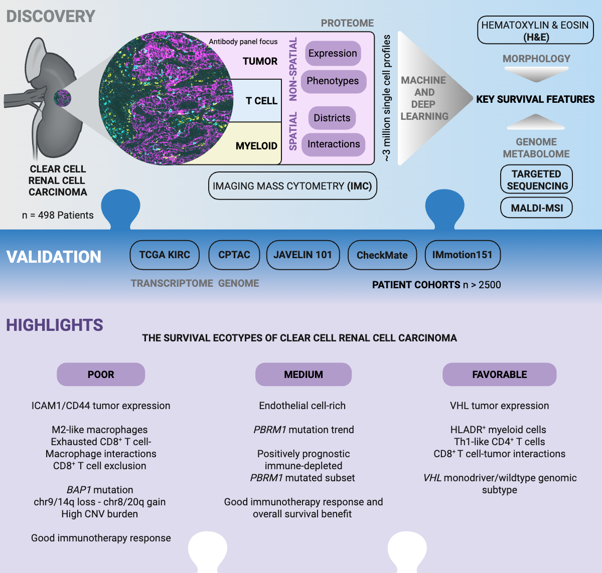

# A spatial multi-omic portrait of survival outcome for clear cell renal cell carcinoma, Meyer et al., 2026

This repository contains analysis code for the clear cell renal cell carcinoma 
study from Meyer et al., 2026. Read the **preprint** here: <https://doi.org/10.64898/2026.03.02.26347390>

**DISCLAIMER:**
The study is currently undergoing peer-review.
Therefore, the code base is under active development.
It includes code for all presented figures in the manuscript.

  

## Abstract

Clear cell renal cell carcinoma (ccRCC) is the leading cause of kidney cancer-related death, but how the tumor microenvironment shapes patient survival is not completely understood.
Here, we describe the characterization of ccRCC tumor ecosystems from 498 patients using imaging mass cytometry with a focus on tumor, myeloid, and T cell landscapes.
Data from more than 3 million single cells is analyzed using machine-learning to identify key ecosystem features that outperform basic clinical data for predicting patient survival.
We define three survival ecotypes of ccRCC: Poor ecotypes, correlate with the worst survival, have high levels of ICAM1 and CD44 expression in tumor cells and are enriched in M2-like macrophages and interactions of exhausted CD8+ T cells with macrophages.
Favorable ecotypes are characterized by high levels of VHL on tumor cells and of HLADR on myeloid cells and contain Th1-like CD4+ T cells.
Medium ecotypes have the highest endothelial cell density.
Multi-omic characterization of these ecotypes using targeted genomic sequencing and metabolic imaging reveals distinct genomic and metabolic features, including BAP1 mutations in Poor, VHL monodriver/wild-type status in Favorable and a positively prognostic immune-depleted PBRM1 mutated subset in Medium patients.
We show that deep learning allows ecotype prediction directly from standard pathology H&E images.
We validate the ecotypes and their associated molecular characteristics with orthogonal omics data across five clinical cohorts and more than 2,500 patients.
These analyses highlight distinct treatment responses and survival benefits across ecotypes.
In summary, our study distills the survival-relevant information encoded in the ccRCC tumor microenvironment into prognostic survival ecotypes, which may inform clinical decision making in the future.

## Repository structure

This repository contains data analysis scripts for **re-creating all manuscript figures** based on provided data analysis objects from **Zenodo**. Example download code is provided across scripts. File paths have to be adjusted by the user.

## Data access

Data is provided on **Zenodo** and the **European Nucleotide Archive**, and will be 
publicly released upon publication.

| Data type | Repository | Link |
|---|---|---|
| Data analysis objects | Zenodo |  |
| IMC data | Zenodo |  |
| H&E data | Zenodo |  |
| Genomics/metabolomics data | Zenodo |  |
| Raw genomics data | European Nucleotide Archive |  |

**NOTE:** Processed IMC datasets will be added to the **imcdatasets** R/Bioconductor package upon publication.

## Software note

Scripts are written in the programming languages **R** and **Python**.
**R code** was run with `R version 4.3.2` on Ubuntu 20.04.4.
**Python code** was run with `Python 3.10.0` using conda. Package versions are provided across scripts.

## License 

## Issues

For problems and questions, please open an issue [here](https://github.com/BodenmillerGroup/RCC_publication/issues).

## ✉️ Code-related contact

[Lasse Meyer](https://github.com/lassedochreden) lasse.meyer 'at' dqbm.uzh.ch
